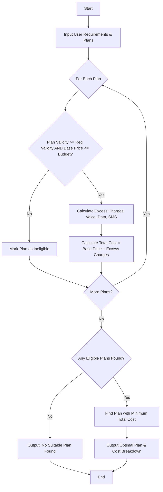

Here is a complete solution for the **Multi-Plan Telecommunications Cost Optimization** problem, structured with a problem statement, algorithm, flowchart, Python implementation, and sample input/output.

---

## 1. Problem Statement

Given a user's telecommunications requirements (voice minutes, data usage in GB, SMS count, minimum validity in days, and maximum budget), evaluate a list of available mobile plans. Each plan has a base price, validity period, included allowances, and specific excess usage charges for voice, data, and SMS.

Your task is to:

1. Filter out plans that do not meet the minimum validity or exceed the maximum budget.
2. Calculate the total cost for each eligible plan (Base Price + Excess Voice Charges + Excess Data Charges + Excess SMS Charges).
3. Identify and recommend the most economical eligible plan (the one with the lowest total cost).

---

## 2. Algorithm

1. **Initialize Inputs:** Receive user requirements (voice, data, sms, validity, budget) and a list of available mobile plans.
2. **Filter Plans:** Loop through each plan in the list:
* Check if `plan.validity >= required_validity`.
* Check if `plan.base_price <= max_budget`.
* If a plan fails either condition, mark it as **ineligible**.


3. **Calculate Excess & Total Cost for Eligible Plans:**
* **Excess Voice:** $\max(0, \text{used\_voice} - \text{included\_voice}) \times \text{rate\_voice}$
* **Excess Data:** $\max(0, \text{used\_data} - \text{included\_data}) \times \text{rate\_data}$
* **Excess SMS:** $\max(0, \text{used\_sms} - \text{included\_sms}) \times \text{rate\_sms}$
* **Total Cost:** $\text{Base Price} + \text{Excess Voice} + \text{Excess Data} + \text{Excess SMS}$


4. **Evaluate Optimization:** Compare the total costs of all eligible plans.
5. **Output Result:** Display the breakdown for all evaluated plans and select the plan with the minimum total cost. If no plans are eligible, notify the user.

---

## 3. Flowchart



---

## 4. Python Source Code

```python
class MobilePlan:
    def __init__(self, name, base_price, validity, inc_voice, inc_data, inc_sms, rate_voice, rate_data, rate_sms):
        self.name = name
        self.base_price = base_price
        self.validity = validity
        self.inc_voice = inc_voice
        self.inc_data = inc_data
        self.inc_sms = inc_sms
        self.rate_voice = rate_voice
        self.rate_data = rate_data
        self.rate_sms = rate_sms

def optimize_telecom_plans(user_reqs, plans):
    req_voice = user_reqs['voice']
    req_data = user_reqs['data']
    req_sms = user_reqs['sms']
    req_validity = user_reqs['validity']
    req_budget = user_reqs['budget']
    
    eligible_plans = []
    
    print(f"{'Plan Name':<12} | {'Status':<12} | {'Base Price':<10} | {'Excess Cost':<12} | {'Total Cost':<10}")
    print("-" * 65)
    
    for plan in plans:
        # Constraint check
        if plan.validity < req_validity or plan.base_price > req_budget:
            print(f"{plan.name:<12} | {'Ineligible':<12} | ${plan.base_price:<9.2f} | {'N/A':<12} | {'N/A':<10}")
            continue
            
        # Excess charges calculation
        excess_voice = max(0, req_voice - plan.inc_voice) * plan.rate_voice
        excess_data = max(0, req_data - plan.inc_data) * plan.rate_data
        excess_sms = max(0, req_sms - plan.inc_sms) * plan.rate_sms
        
        total_excess = excess_voice + excess_data + excess_sms
        total_cost = plan.base_price + total_excess
        
        eligible_plans.append({
            'plan': plan,
            'total_cost': total_cost,
            'excess_cost': total_excess
        })
        
        print(f"{plan.name:<12} | {'Eligible':<12} | ${plan.base_price:<9.2f} | ${total_excess:<11.2f} | ${total_cost:<9.2f}")
        
    print("-" * 65)
    
    if not eligible_plans:
        return "No eligible plans found within the budget and validity constraints."
        
    # Find the most economical plan (minimum total cost)
    optimal = min(eligible_plans, key=lambda x: x['total_cost'])
    return optimal

# --- Sample Execution ---
if __name__ == "__main__":
    # User Requirements
    user_requirements = {
        'voice': 500,     # minutes
        'data': 15.0,     # GB
        'sms': 100,       # messages
        'validity': 30,   # days
        'budget': 50.0    # dollars
    }
    
    # Available Mobile Plans Database
    available_plans = [
        # name, price, validity, inc_voice, inc_data, inc_sms, rate_voice, rate_data, rate_sms
        MobilePlan("Plan Alpha", 35.0, 30, 400, 10.0, 50, 0.10, 2.00, 0.05),
        MobilePlan("Plan Beta",  45.0, 30, 600, 20.0, 150, 0.05, 1.50, 0.02),
        MobilePlan("Plan Gamma", 55.0, 30, 1000, 50.0, 500, 0.02, 1.00, 0.01), # Exceeds budget
        MobilePlan("Plan Delta", 40.0, 15, 500, 15.0, 100, 0.08, 1.80, 0.04)  # Fails validity
    ]
    
    best_plan_result = optimize_telecom_plans(user_requirements, available_plans)
    
    if isinstance(best_plan_result, dict):
        print(f"\n✨ **Most Economical Recommended Plan:** {best_plan_result['plan'].name}")
        print(f"   - Base Price: ${best_plan_result['plan'].base_price:.2f}")
        print(f"   - Excess Charges: ${best_plan_result['excess_cost']:.2f}")
        print(f"   - Final Total Cost: ${best_plan_result['total_cost']:.2f}")
    else:
        print(f"\n{best_plan_result}")

```

---

## 5. Sample Input

* **User Requirements:**
* Voice Usage: `500 minutes`
* Data Usage: `15.0 GB`
* SMS Usage: `100 messages`
* Minimum Validity: `30 days`
* Maximum Budget: `$50.00`


* **Available Plans:**
* **Plan Alpha:** Cost: `$35.00`, Validity: `30 days`, Inc: `400m / 10GB / 50sms`, Excess Rates: `$0.10/m`, `$2.00/GB`, `$0.05/sms`
* **Plan Beta:** Cost: `$45.00`, Validity: `30 days`, Inc: `600m / 20GB / 150sms`, Excess Rates: `$0.05/m`, `$1.50/GB`, `$0.02/sms`
* **Plan Gamma:** Cost: `$55.00`, Validity: `30 days`, Inc: `1000m / 50GB / 500sms`, Excess Rates: `$0.02/m`, `$1.00/GB`, `$0.01/sms`
* **Plan Delta:** Cost: `$40.00`, Validity: `15 days`, Inc: `500m / 15GB / 100sms`, Excess Rates: `$0.08/m`, `$1.80/GB`, `$0.04/sms`


---

## 6. Sample Output

```text
Plan Name    | Status       | Base Price | Excess Cost  | Total Cost
-----------------------------------------------------------------
Plan Alpha   | Eligible     | $35.00     | $12.50       | $47.50    
Plan Beta    | Eligible     | $45.00     | $0.00        | $45.00    
Plan Gamma   | Ineligible   | $55.00     | N/A          | N/A       
Plan Delta   | Ineligible   | $40.00     | N/A          | N/A       
-----------------------------------------------------------------

✨ **Most Economical Recommended Plan:** Plan Beta
   - Base Price: $45.00
   - Excess Charges: $0.00
   - Final Total Cost: $45.00

```
