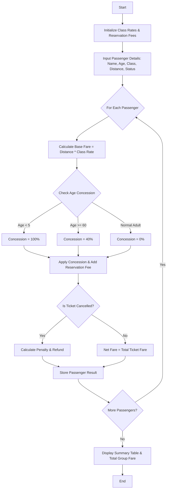

Here is a complete solution for the **Railway Fare and Reservation Calculator** problem, structured with a problem statement, algorithm, flowchart, Python implementation, and sample input/output.

---

## 1. Problem Statement

Design a system to calculate the total railway fare for multiple passengers traveling across various travel classes and distances. The fare calculation must factor in:

1. **Distance Slabs / Per-KM Rates:** Base rate per kilometer depending on the chosen travel class (e.g., Sleeper, AC 3-Tier, AC 2-Tier, First AC).
2. **Age-Based Concessions:** Discounts applied to the base fare based on passenger age (e.g., Senior Citizens, Children).
3. **Reservation Fees:** Fixed booking/reservation charges specific to each travel class.
4. **Cancellation Penalties:** Optional calculation of refund amounts or penalty charges if a ticket is canceled.

---

## 2. Algorithm

1. **Initialize Pricing Rules:** Define per-km rates and fixed reservation fees for each travel class (Sleeper, AC 3-Tier, AC 2-Tier, First AC).
2. **Define Concession Rules:**
* Children (Age < 5): 100% concession (Free).
* Senior Citizens (Age $\ge$ 60): 40% concession on base fare.
* Adults (5 $\le$ Age < 60): No concession (0%).


3. **Process Each Passenger:**
* Compute **Base Fare** = $\text{Distance (km)} \times \text{Per-KM Rate for Class}$.
* Compute **Concession Amount** = $\text{Base Fare} \times \text{Concession Percentage}$.
* Compute **Discounted Base Fare** = $\text{Base Fare} - \text{Concession Amount}$.
* Add **Reservation Fee** for the class to get the **Total Ticket Fare**.
* If the ticket is marked as canceled, compute the **Cancellation Penalty** and **Refund Amount**.


4. **Aggregate Results:** Sum up individual fares to display a comprehensive billing summary for all passengers.

---

## 3. Flowchart



---

## 4. Python Source Code

```python
class Passenger:
    def __init__(self, name, age, travel_class, distance_km, is_cancelled=False):
        self.name = name
        self.age = age
        self.travel_class = travel_class
        self.distance_km = distance_km
        self.is_cancelled = is_cancelled

def calculate_railway_fares(passengers):
    # Rate configuration per KM and fixed reservation fees per class
    class_rates = {
        'Sleeper': 1.50,
        'AC_3Tier': 2.75,
        'AC_2Tier': 3.80,
        'First_AC': 5.00
    }
    
    reservation_fees = {
        'Sleeper': 20.0,
        'AC_3Tier': 40.0,
        'AC_2Tier': 50.0,
        'First_AC': 60.0
    }
    
    print(f"{'Passenger Name':<15} | {'Class':<10} | {'Base Fare':<10} | {'Concession':<10} | {'Resv Fee':<10} | {'Final Fare':<10} | {'Status':<10}")
    print("-" * 88)
    
    total_group_fare = 0.0
    
    for p in passengers:
        if p.travel_class not in class_rates:
            print(f"Error: Invalid travel class '{p.travel_class}' for {p.name}")
            continue
            
        # 1. Base Fare Calculation
        base_fare = p.distance_km * class_rates[p.travel_class]
        
        # 2. Age-Based Concession
        concession_rate = 0.0
        if p.age < 5:
            concession_rate = 1.00  # 100% off (Free)
        elif p.age >= 60:
            concession_rate = 0.40  # 40% off for senior citizens
            
        concession_amount = base_fare * concession_rate
        discounted_base = base_fare - concession_amount
        
        # 3. Reservation Fee
        res_fee = reservation_fees[p.travel_class] if p.age >= 5 else 0.0
        
        # 4. Total Ticket Fare
        ticket_fare = discounted_base + res_fee
        
        # 5. Cancellation Logic
        status = "Confirmed"
        if p.is_cancelled:
            status = "Cancelled"
            penalty = 50.0  # Flat cancellation fee
            refund = max(0, ticket_fare - penalty)
            ticket_fare = 0.0 # Billed amount becomes zero, refund processed separately
            
        total_group_fare += ticket_fare
        
        print(f"{p.name:<15} | {p.travel_class:<10} | ${base_fare:<9.2f} | ${concession_amount:<9.2f} | ${res_fee:<9.2f} | ${ticket_fare:<9.2f} | {status:<10}")
        
    print("-" * 88)
    print(f"💰 **Total Group Railway Fare:** ${total_group_fare:.2f}")

# --- Sample Execution ---
if __name__ == "__main__":
    # Sample Passenger List
    passenger_list = [
        Passenger("Alice Smith", 28, "AC_3Tier", 450, is_cancelled=False),
        Passenger("Bob Jones", 65, "Sleeper", 300, is_cancelled=False),       # Senior Citizen
        Passenger("Charlie Brown", 3, "AC_2Tier", 800, is_cancelled=False),    # Infant (<5 free)
        Passenger("Diana Prince", 45, "First_AC", 1200, is_cancelled=True)     # Cancelled ticket
    ]
    
    calculate_railway_fares(passenger_list)

```

---

## 5. Sample Input

* **Pricing Rates:**
* Sleeper: `$1.50/km`, Fee: `$20.00`
* AC 3-Tier: `$2.75/km`, Fee: `$40.00`
* AC 2-Tier: `$3.80/km`, Fee: `$50.00`
* First AC: `$5.00/km`, Fee: `$60.00`


* **Passengers:**
1. `Alice Smith`: Age `28`, Class `AC_3Tier`, Distance `450 km`, Status: `Active`
2. `Bob Jones`: Age `65`, Class `Sleeper`, Distance `300 km`, Status: `Active`
3. `Charlie Brown`: Age `3`, Class `AC_2Tier`, Distance `800 km`, Status: `Active`
4. `Diana Prince`: Age `45`, Class `First_AC`, Distance `1200 km`, Status: `Cancelled`


---

## 6. Sample Output

```text
Passenger Name  | Class      | Base Fare  | Concession | Resv Fee   | Final Fare | Status    
----------------------------------------------------------------------------------------
Alice Smith     | AC_3Tier   | $1237.50   | $0.00      | $40.00     | $1277.50   | Confirmed 
Bob Jones       | Sleeper    | $450.00    | $180.00    | $20.00     | $290.00    | Confirmed 
Charlie Brown   | AC_2Tier   | $3040.00   | $3040.00   | $0.00      | $0.00      | Confirmed 
Diana Prince    | First_AC   | $6000.00   | $0.00      | $60.00     | $0.00      | Cancelled 
----------------------------------------------------------------------------------------
💰 **Total Group Railway Fare:** $1567.50

```
